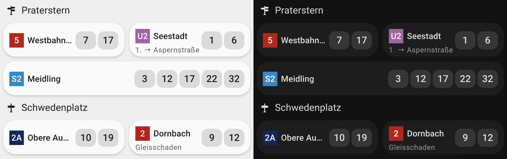
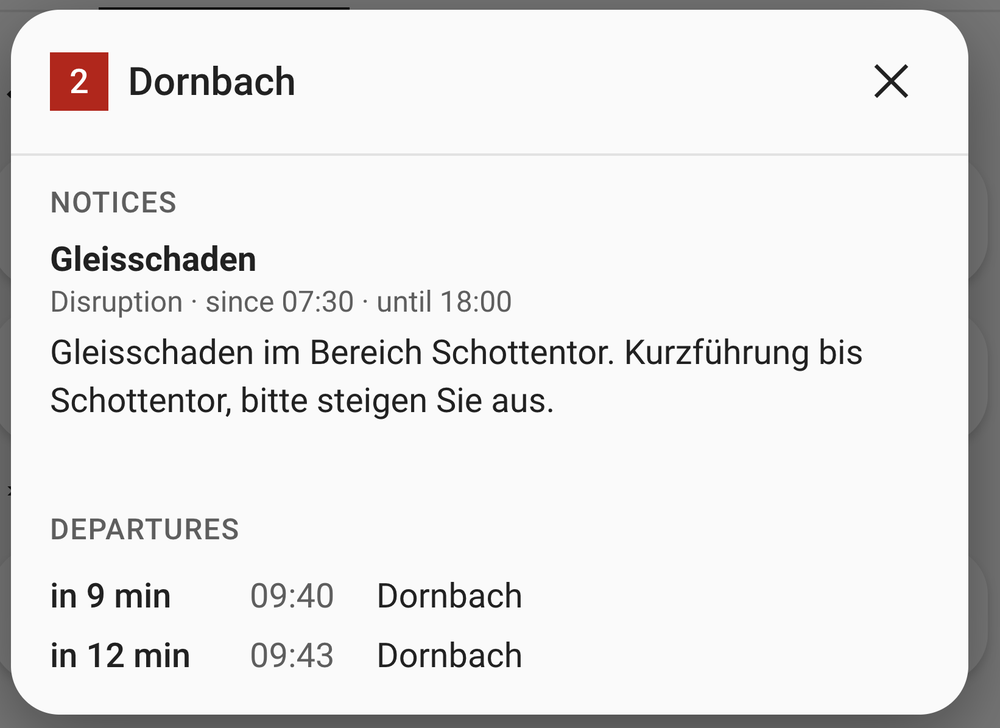
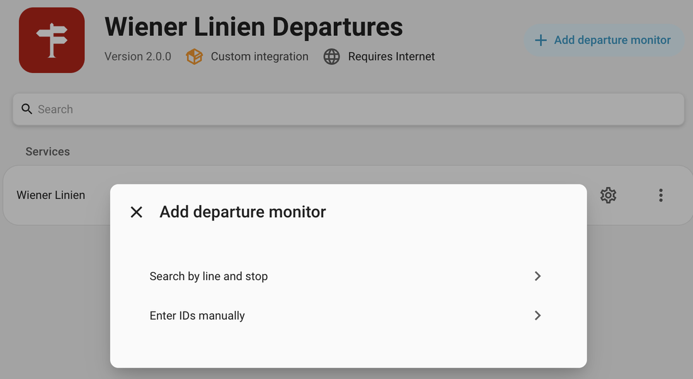
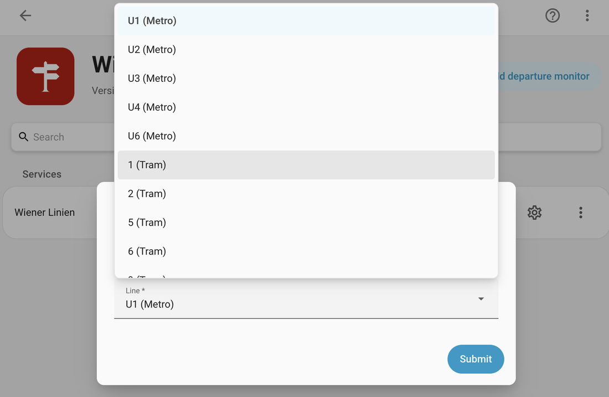
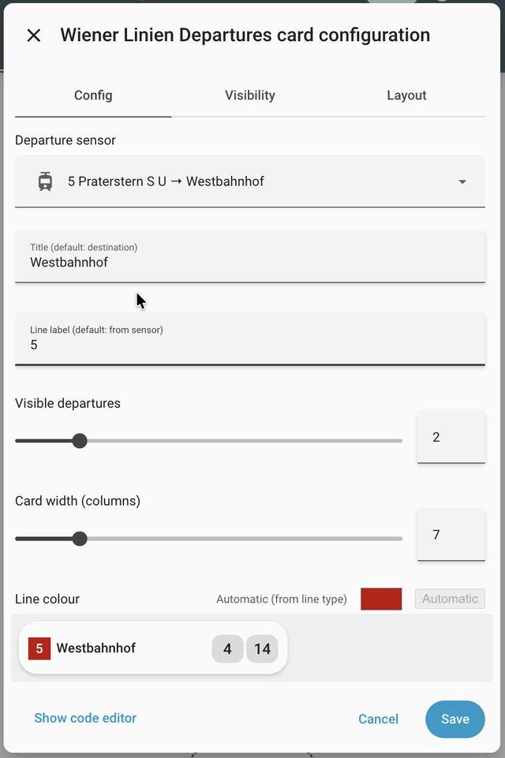

# Wiener Linien Departures for Home Assistant

Home Assistant integration that shows real-time departures of Vienna's public transport (Wiener Linien) on a dashboard. It consists of a config-flow based integration for choosing lines and stops and a custom card that displays the departures and current disruption notices.

## Features

- Real-time departures for U-Bahn, trams and buses, shown as minutes until departure
- Distinction between live data and timetable times
- Disruption notices and traffic jams displayed on the card, with the full text and all upcoming departures in a details popup
- Detection of vehicles that do not go to the expected destination (short runs, diversions)
- Setup in the UI: line, stop and direction are selected from lists, no IDs or YAML required (manual ID entry is available as a fallback)
- Line colours by line type, configurable number of departures, card width and title
- Visual card editor
- Available in English and German
- Data is fetched only while a card is visible, with a single API request for all monitored stops and a configurable update interval
- All processing takes place in Home Assistant, so the dashboard stays responsive on low-end devices such as wall-mounted tablets

## Installation

Requires Home Assistant 2025.3 or newer.

### HACS

1. Open HACS, choose *Custom repositories* from the menu and add `https://github.com/thoebert/Wiener-Linien-HA-Dashboard` as type **Integration**
2. Install **Wiener Linien Departures**
3. Restart Home Assistant

### Manual

Copy the folder `custom_components/wiener_linien` into the `custom_components` folder of the Home Assistant configuration and restart Home Assistant.

## Setup

### 1. Add the integration

*Settings → Devices & services → Add integration → Wiener Linien*

### 2. Add departure monitors

On the integration page, *Add departure monitor* creates one monitor. A monitor is one line at one stop in one direction.

With *Search by line and stop*, the line, the stop and the destination are selected one after another. The destination determines the platform and therefore the direction. This is repeated for each line that should be displayed.

### 3. Add the card

*Edit dashboard → Add card → Wiener Linien Departures*

The card editor offers the monitor, title, number of departures, card width and line colour. The line colour is derived from the line type by default.

Clicking a card opens the details popup.

## Notes

- Departures are loaded while a dashboard containing the card is open. The default update interval is 30 seconds and can be changed under *Configure* on the integration page (minimum 15 seconds).
- An underlined number marks a time without live data, taken from the timetable.
- A `*` marks a vehicle that is departing now.
- The interface language follows the Home Assistant language setting. English and German are supported, both in the setup dialogs and on the card.

## Documentation

- [Configuration reference](CONFIGURATION.md): settings, manual stop IDs, card options, troubleshooting, YAML configuration
- [Architecture](ARCHITECTURE.md): structure of the integration and design decisions
- [Development](DEVELOPMENT.md): deployment, testing and development notes

## License

[MIT](LICENSE)

## Data source

Real-time data and open data: Stadt Wien – data.wien.gv.at / Wiener Linien (CC BY 4.0). This project is not affiliated with Wiener Linien.
